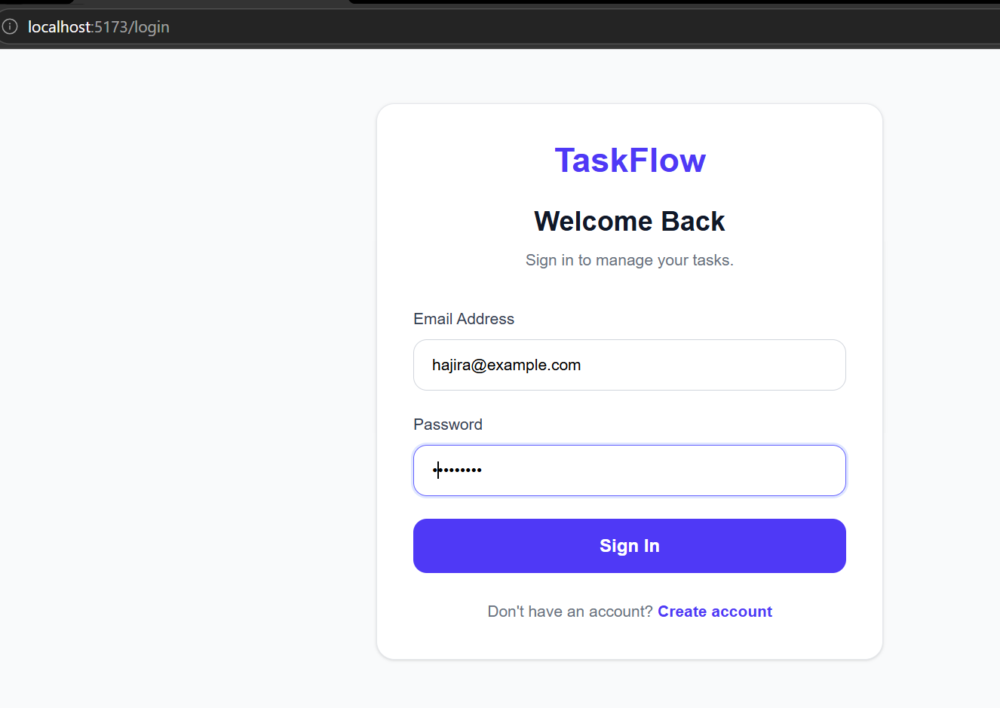
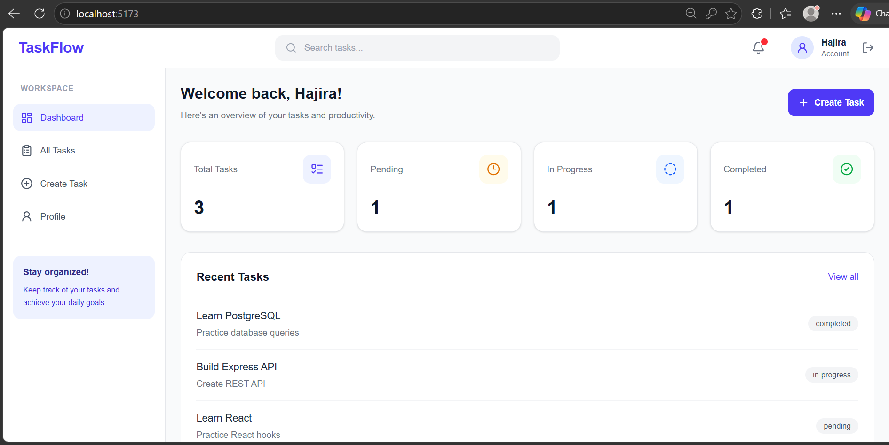
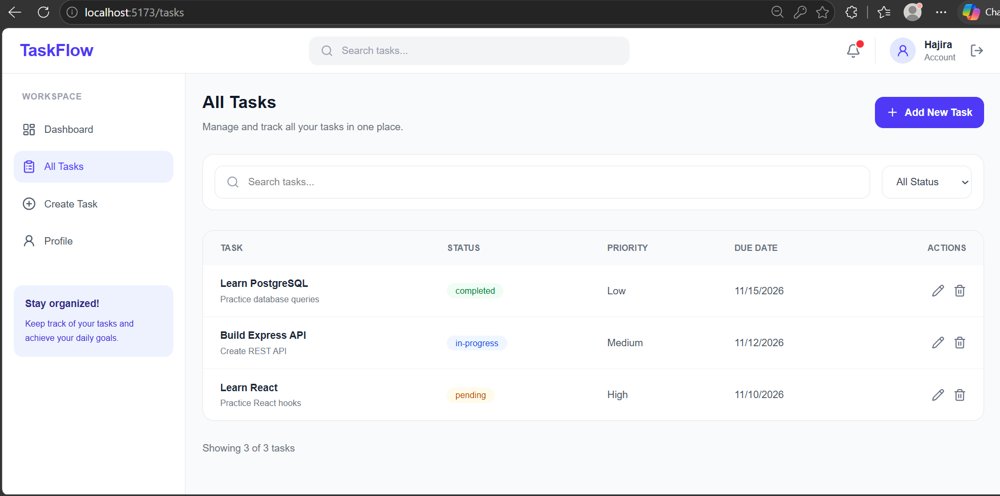
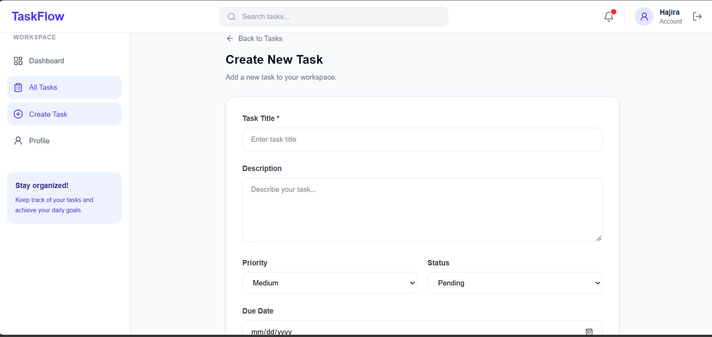
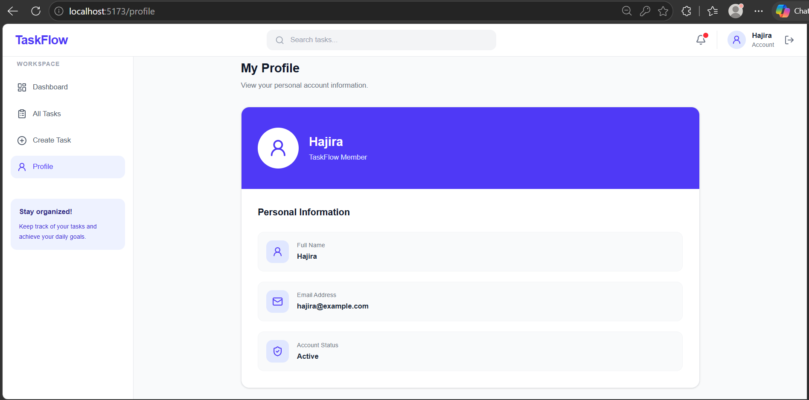
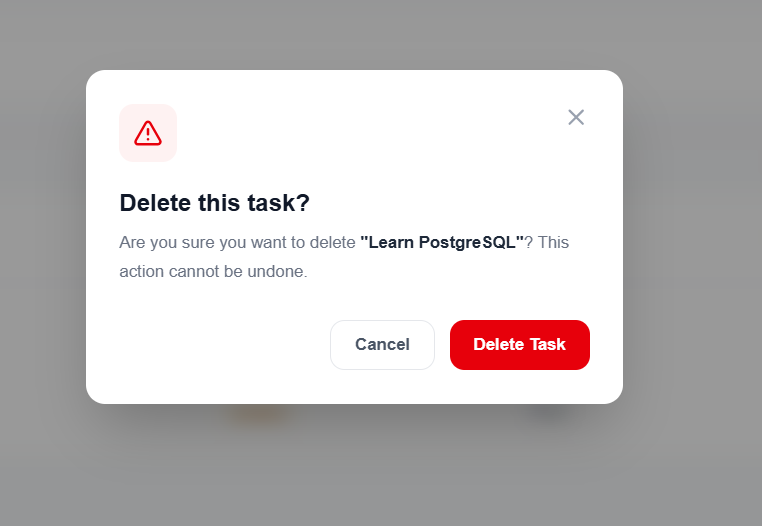

# TaskFlow | Task Management System

A modern full-stack task management application designed to help users organize their work, manage daily tasks, and stay productive.

## Application Preview

### Authentication

<table>
  <tr>
    <td align="center"><b>Login</b></td>
  </tr>
  <tr>
    <td></td>
  </tr>
</table>

### Dashboard & Task Management

<table>
  <tr>
    <td align="center"><b>Dashboard</b></td>
    <td align="center"><b>All Tasks</b></td>
  </tr>
  <tr>
    <td></td>
    <td></td>
  </tr>
</table>

### Task Creation & User Profile

<table>
  <tr>
    <td align="center"><b>Create Task</b></td>
    <td align="center"><b>User Profile</b></td>
  </tr>
  <tr>
    <td></td>
    <td></td>
  </tr>
</table>

### Confirmation Dialog

<table>
  <tr>
    <td align="center"><b>Delete Task Confirmation</b></td>
  </tr>
  <tr>
    <td></td>
  </tr>
</table>

## Key Features

- **Authentication:** User registration and login with JWT authentication.
- **Dashboard:** Overview of tasks and their current statuses.
- **Task Management:** Create, view, edit, and delete tasks.
- **Search & Filtering:** Search tasks by title and filter by status.
- **Task Priorities:** Organize tasks by Low, Medium, and High priority.
- **Due Dates:** Set deadlines for individual tasks.
- **User Profile:** View personal account information.
- **Confirmation Modals:** Custom confirmation dialogs for delete and logout actions.
- **Responsive UI:** Clean and responsive interface for different screen sizes.

## Tech Stack

| Frontend | Backend | Database |
|---|---|---|
| React | Node.js | PostgreSQL |
| Vite | Express.js | |
| Tailwind CSS | JWT | |
| React Router | bcryptjs | |
| Axios | REST API | |
| Lucide React | | |

## Project Structure

```text
Task-Management/
│
├── frontend/
│   ├── .gitignore
│   ├── src/
│   │   ├── assets/
│   │   │   └── screenshots/
│   │   ├── components/
│   │   ├── context/
│   │   ├── pages/
│   │   ├── services/
│   │   ├── App.jsx
│   │   └── main.jsx
│   └── package.json
│
├── backend/
│   ├── .gitignore
│   ├── config/
│   ├── controllers/
│   ├── middleware/
│   ├── models/
│   ├── routes/
│   ├── server.js
│   └── package.json
│
└── README.md
```

## Getting Started

### Prerequisites

Make sure you have the following installed:

- Node.js
- PostgreSQL
- npm
- Git

### 1. Clone the Repository

```bash
git clone https://github.com/YOUR_USERNAME/YOUR_REPOSITORY.git
cd YOUR_REPOSITORY
```

### 2. Backend Setup

Navigate to the backend directory:

```bash
cd backend
npm install
```

Create a `.env` file inside the backend directory:

```env
PORT=5001
DB_USER=your_database_user
DB_HOST=localhost
DB_NAME=task_management
DB_PASSWORD=your_database_password
DB_PORT=5432
JWT_SECRET=your_secret_key
```

Create a PostgreSQL database named `task_management` and configure the required tables.

Start the backend server:

```bash
npm run dev
```

### 3. Frontend Setup

Open a new terminal and navigate to the frontend directory:

```bash
cd frontend
npm install
npm run dev
```

Open the application in your browser:

```text
http://localhost:5173
```

## API Endpoints

| Method | Endpoint | Description |
|---|---|---|
| POST | `/api/auth/register` | Register a new user |
| POST | `/api/auth/login` | Authenticate a user |
| GET | `/api/tasks` | Retrieve all tasks |
| GET | `/api/tasks/:id` | Retrieve a single task |
| POST | `/api/tasks` | Create a new task |
| PUT | `/api/tasks/:id` | Update a task |
| DELETE | `/api/tasks/:id` | Delete a task |

## Security

- Password hashing using bcryptjs.
- JWT-based authentication.
- Protected API routes.
- Environment variables for sensitive configuration.

## Author

**Hajira Yousuf Ali**

Software Engineering Student | Full-Stack Developer

- **GitHub:** [HajiraYousuf](https://github.com/HajiraYousuf)
- **LinkedIn:** [Hajira Yousuf](https://linkedin.com/in/hajira-yousuf/)

---

<p align="center">
  Built with React, Node.js, Express.js & PostgreSQL
</p>``